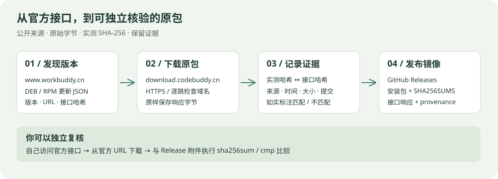

# WorkBuddy Linux Tracker

[](https://github.com/jiashuaibei/workbuddy-linux-tracker/actions/workflows/mirror-releases.yml) [](https://github.com/jiashuaibei/workbuddy-linux-tracker/actions/workflows/track-releases.yml)

[下载与版本历史](https://workbuddy-linux-tracker.vercel.app/) · [Releases 原包镜像](https://github.com/jiashuaibei/workbuddy-linux-tracker/releases) · [自动发布记录](https://github.com/jiashuaibei/workbuddy-linux-tracker/actions/workflows/mirror-releases.yml)

追踪 WorkBuddy 公开更新接口中的 **Linux x86_64 DEB / RPM 原包**，保留官方下载入口，并定时镜像到 GitHub Releases。本项目由社区维护，与腾讯无官方隶属关系。

> 官网的下载入口与更新服务是两个不同的入口。这个项目通过官网公开更新接口发现通用包，不需要进入麒麟专有商店。DEB / RPM 是包格式，不能据此保证所有 Linux 发行版均兼容。



## 为什么能追踪到官网页面上没有直接列出的包？

公开更新接口接受 `platform` 参数，分别返回对应平台的版本和下载 URL：

| 格式 | 平台参数 | 可独立查看的官方来源 |
| --- | --- | --- |
| DEB | `workbuddy-linux-x64-deb` | [打开 JSON](https://www.workbuddy.cn/v2/update?platform=workbuddy-linux-x64-deb) |
| RPM | `workbuddy-linux-x64-rpm` | [打开 JSON](https://www.workbuddy.cn/v2/update?platform=workbuddy-linux-x64-rpm) |

接口返回 `version`、`productVersion`、`url`、`sha256hash`、`timestamp` 等字段。脚本读取真实的 `url`，不靠猜测文件名或递增版本号寻找安装包。目前接口指向 `download.codebuddy.cn`；只允许 `www.workbuddy.cn` 和 `download.codebuddy.cn` 的 HTTPS 地址，镜像下载的每一跳重定向也检查域名。域名变化会停止下载，需审查后更新允许列表。

你可以自己复现发现过程（只需 Python 3）：

```bash
curl -fsS 'https://www.workbuddy.cn/v2/update?platform=workbuddy-linux-x64-deb' \
  | python3 -m json.tool
python3 scripts/track_official.py
# 实际下载并生成来源证据，不上传到 GitHub：
python3 scripts/publish_official.py --format deb --dry-run
python3 scripts/publish_official.py --format rpm --dry-run
```

完整产品版本会保留，不与 DEB 内部较短的版本字段混同。历史从首次观测开始，不能还原此前所有版本。同格式、版本、URL 和接口哈希相同则去重；发生变化则新增记录。某个接口失败时保留上一次有效数据，并记录错误。

## 怎样确认镜像包没有被修改？

网页的官方下载按钮直接链接上游；Releases 则提供同一来源文件的社区镜像。镜像脚本只读取 HTTP 响应字节、写入文件并计算 SHA-256，不执行安装包、不解包、不重新构建。附件可能使用统一命名，但文件内容保持原样。

每个新 Release 包含：

| 附件 | 用途 |
| --- | --- |
| `WorkBuddy-版本-linux-x86_64.deb` / `.rpm` | 从官方 URL 原样下载的安装包 |
| `SHA256SUMS` | 对实际下载字节计算的 SHA-256 |
| `upstream-response.json` | 本次请求得到的原始官方接口响应 |
| `provenance.json` | 来源 URL、最终 URL、版本、大小、下载时间、实测与接口哈希、比对结果、脚本提交和 Actions 运行链接 |

**第一步：检查你拿到的附件与发布记录一致。** 把安装包和同一个 Release 中的 `SHA256SUMS` 放到同一个目录：

```bash
sha256sum -c SHA256SUMS
```

**第二步：独立从官方来源下载并比较。** 先亲自打开上面的官方接口，核对 `provenance.json` 中的 URL 和域名，再执行：

```bash
# 在含安装包与 provenance.json 的目录执行
python3 - <<'PY'
import json, pathlib, subprocess
p = json.loads(pathlib.Path('provenance.json').read_text())
subprocess.run(['curl', '--fail', '--location', '--proto', '=https',
                '--proto-redir', '=https', '--output', 'official-package', p['url']], check=True)
subprocess.run(['sha256sum', p['filename'], 'official-package'], check=True)
subprocess.run(['cmp', p['filename'], 'official-package'], check=True)
print('两份文件逐字节一致')
PY
```

`cmp` 成功表示两份文件逐字节相同。上游若已替换或删除历史文件，需要结合当时的来源记录分析，不能只凭文件名判断。

**信任边界也公开：** 本项目生成的 SHA-256 能检查附件完整性，但仓库维护者同时控制附件和校验文件，因此仅凭本站校验文件不能独立证明官方身份。自行访问官方接口、从官方域名下载并比较，能减少对本项目的信任依赖。来源记录和 Actions 日志方便审查，也不是腾讯数字签名或软件安全审计。

曾观察到接口哈希与下载文件不一致，因此 `reportedSha256`（接口值）与 `actualSha256`（实测值）分别保存。发布说明明确给出 `match` / `mismatch` / `not-provided`；后两种仍镜像官方 HTTPS 返回的字节，但明确提示**未通过上游哈希验证**。网页只追踪接口数据，仍标注接口哈希“未验证”，不能将网页记录误认为每次都下载校验过。

> **历史包提醒：** 旧 `v5.4.5` Release 是历史社区重新封装的构建，不属于这里的官方原包镜像。旧构建脚本仅作历史参考，新镜像工作流不调用它们。请选择 `official-` 开头的新 Release，或直接使用官方下载链接。

## 自动检查与发布

- **版本记录：** `track-releases.yml` 每小时第 17 分钟运行，保存 `web/data/releases.json` 并部署 GitHub Pages。Vercel 网页独立托管，Root Directory 为 `web`。
- **原包镜像：** `mirror-releases.yml` 每小时第 37 分钟运行（北京时间也为每小时第 37 分钟），支持 Actions → **Mirror official Linux packages** → **Run workflow** 手动触发。修改镜像代码并推送 main 也会触发。
- DEB 和 RPM 分开发布与重试，一种格式失败不会阻止另一种。按“格式 + 版本 + URL + 接口哈希”确定 Release 标识；没有变化则跳过大文件下载，不重复发布。若上游在 URL、版本及接口哈希都不变时静默更换文件，当前去重策略不会发现。
- 先创建草稿，上传完整附件后再公开；失败可在下次运行恢复草稿。已公开的 Release 不自动覆盖。发布时保留其他版本的 Latest 标记，因此请从 Releases 列表按版本与格式选择。
- 工作流只使用仓库自带的 `GITHUB_TOKEN`，无需额外 PAT；包镜像任务需要 `contents: write`，与 Pages 部署成功与否无关。

**运行状态：** 2026-11-09 已恢复云端自动化，并完成手动验收：[原包镜像运行成功](https://github.com/jiashuaibei/workbuddy-linux-tracker/actions/runs/42578906236)，DEB / RPM 均通过 12 项测试，并在确认版本已发布后正常跳过；[版本追踪与 Pages 部署成功](https://github.com/jiashuaibei/workbuddy-linux-tracker/actions/runs/42578923098)，已刷新版本记录。此前手动停用的追踪工作流已重新启用。当前包已存在，因此本次没有重复上传或覆盖 Release；后续发现新版本时自动下载并发布。

公开仓库使用标准运行器免费，无需为本项目购买套餐。GitHub 调度可能延迟；公开仓库长期没有活动也可能暂停定时任务。以 Actions 实际运行结果与 Release 附件为准；如再次出现账号级账单锁定，请参阅 [GitHub 官方解锁指引](https://docs.github.com/en/billing/how-tos/troubleshooting/locked-account)。

## 开发与范围

核心代码：[发现与历史](scripts/track_official.py) · [原包镜像与证据](scripts/publish_official.py) · [发布工作流](.github/workflows/mirror-releases.yml)。

```bash
bash scripts/test.sh
python3 -m http.server 8001 --bind 127.0.0.1 --directory web
```

当前仅追踪 x86_64。源码采用 MIT 许可证，WorkBuddy 二进制与品牌归其权利人所有，其许可不因镜像改变。
