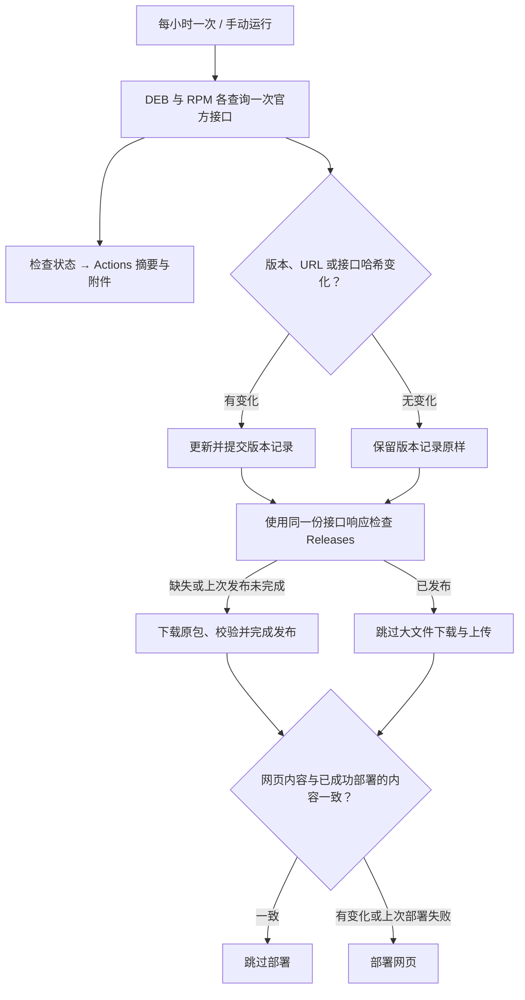

# WorkBuddy Linux

[](https://github.com/jiashuaibei/workbuddy-linux/actions/workflows/track-releases.yml)

[下载与版本历史](https://jiashuaibei.github.io/workbuddy-linux/) · [Releases 原包镜像](https://github.com/jiashuaibei/workbuddy-linux/releases) · [自动发布记录](https://github.com/jiashuaibei/workbuddy-linux/actions/workflows/track-releases.yml)

腾讯面向银河麒麟、统信 UOS 提供 WorkBuddy Linux 客户端，也提供了由腾讯构建的 **通用 Linux x86_64 DEB / RPM 安装包**。本项目只是通过腾讯官方公开更新接口把这些通用安装包追踪出来，提供官方下载链接、版本记录和原包镜像；安装包由腾讯制作，本项目不修改或重新封装当前追踪的官方原包。

本项目由社区维护，与腾讯无官方隶属关系。

> [官方下载页面](https://www.workbuddy.cn/work/)为银河麒麟、统信 UOS 指向系统应用商店；公开更新服务则提供了下方可独立查询的通用包地址。通用包已经存在于腾讯的官方发布渠道，本项目通过接口发现它们，无需把商店专用包转换成通用包。DEB / RPM 是包格式，不代表所有 Linux 发行版都已通过兼容性测试。


## 为什么能追踪到官网页面上没有直接列出的包？

官网展示的下载入口与实际更新服务不同：麒麟、统信 UOS 用户可以从应用商店获取客户端，通用 DEB / RPM 包则能从腾讯官方更新接口发现。这里描述的是可公开核验的发布产物；腾讯内部是否每次都在同一个打包批次生成所有平台版本，公开接口并不能证明。

公开更新接口接受 `platform` 参数，分别返回对应平台的版本和下载 URL：

| 格式 | 平台参数 | 可独立查看的官方来源 |
| --- | --- | --- |
| DEB | `workbuddy-linux-x64-deb` | [打开 JSON](https://www.workbuddy.cn/v2/update?platform=workbuddy-linux-x64-deb) |
| RPM | `workbuddy-linux-x64-rpm` | [打开 JSON](https://www.workbuddy.cn/v2/update?platform=workbuddy-linux-x64-rpm) |

接口返回 `version`、`productVersion`、`url`、`sha256hash`、`timestamp` 等字段。脚本读取真实的 `url`，不靠猜测文件名或递增版本号寻找安装包。目前接口指向 `download.codebuddy.cn`；只允许 `www.workbuddy.cn` 和 `download.codebuddy.cn` 的 HTTPS 地址，镜像下载的每一跳重定向也检查域名。域名变化会停止下载，需审查后更新允许列表。

你可以自己复现发现过程（只需 Python 3）：

```bash
curl -fsS 'https://www.workbuddy.cn/v2/update?platform=workbuddy-linux-x64-deb' \
  | python3 -m json.tool
python3 scripts/track_official.py
# 实际下载并生成来源证据，不上传到 GitHub：
python3 scripts/publish_official.py --format deb --dry-run
python3 scripts/publish_official.py --format rpm --dry-run
```

完整产品版本会保留，不与 DEB 内部较短的版本字段混同。历史从首次观测开始，不能还原此前所有版本。同格式、版本、URL 和接口哈希相同则去重；发生变化则新增记录。某个接口失败时保留上一次有效数据，并记录错误。

## 怎样确认镜像包没有被修改？

网页的官方下载按钮直接链接上游；Releases 则提供同一来源文件的社区镜像。镜像脚本只读取 HTTP 响应字节、写入文件并计算 SHA-256，不执行安装包、不解包、不重新构建。附件可能使用统一命名，但文件内容保持原样。

每个新 Release 包含：

| 附件 | 用途 |
| --- | --- |
| `WorkBuddy-版本-linux-x86_64.deb` / `.rpm` | 从官方 URL 原样下载的安装包 |
| `SHA256SUMS` | 对实际下载字节计算的 SHA-256 |
| `upstream-response.json` | 本次请求得到的原始官方接口响应 |
| `provenance.json` | 来源 URL、最终 URL、版本、大小、下载时间、实测与接口哈希、比对结果、脚本提交和 Actions 运行链接 |

**第一步：检查你拿到的附件与发布记录一致。** 把安装包和同一个 Release 中的 `SHA256SUMS` 放到同一个目录：

```bash
sha256sum -c SHA256SUMS
```

**第二步：独立从官方来源下载并比较。** 先亲自打开上面的官方接口，核对 `provenance.json` 中的 URL 和域名，再执行：

```bash
# 在含安装包与 provenance.json 的目录执行
python3 - <<'PY'
import json, pathlib, subprocess
p = json.loads(pathlib.Path('provenance.json').read_text())
subprocess.run(['curl', '--fail', '--location', '--proto', '=https',
                '--proto-redir', '=https', '--output', 'official-package', p['url']], check=True)
subprocess.run(['sha256sum', p['filename'], 'official-package'], check=True)
subprocess.run(['cmp', p['filename'], 'official-package'], check=True)
print('两份文件逐字节一致')
PY
```

`cmp` 成功表示两份文件逐字节相同。上游若已替换或删除历史文件，需要结合当时的来源记录分析，不能只凭文件名判断。

**信任边界也公开：** 本项目生成的 SHA-256 能检查附件完整性，但仓库维护者同时控制附件和校验文件，因此仅凭本站校验文件不能独立证明官方身份。自行访问官方接口、从官方域名下载并比较，能减少对本项目的信任依赖。来源记录和 Actions 日志方便审查，也不是腾讯数字签名或软件安全审计。

曾观察到接口哈希与下载文件不一致，因此 `reportedSha256`（接口值）与 `actualSha256`（实测值）分别保存。发布说明明确给出 `match` / `mismatch` / `not-provided`；后两种仍镜像官方 HTTPS 返回的字节，但明确提示**未通过上游哈希验证**。网页只追踪接口数据，仍标注接口哈希“未验证”，不能将网页记录误认为每次都下载校验过。

> **历史包提醒：** 旧 `v5.4.5` Release 是历史社区重新封装的构建，不属于这里的官方原包镜像。旧构建脚本仅作历史参考，新镜像工作流不调用它们。请选择 `official-` 开头的新 Release，或直接使用官方下载链接。

## 自动检查与发布

只有一个定时工作流 **Sync official Linux releases**（`track-releases.yml`），在北京时间每小时第 **1** 分钟执行，也支持 Actions → Run workflow。原先第 21 分钟的独立镜像工作流已移除。CI 仍单独检查代码提交，不设置定时任务。



- **版本记录与检查状态分开保存。** `web/data/releases.json` 只保存版本事实、首次发现时间和 `lastChanged`；相同版本、URL 和接口哈希不写文件、不提交主分支。每次检查的时间、成功格式、错误及变化结果保存在 `check-status.json`，与本次原始接口响应一起上传为 `check-status-运行ID-尝试次数` 附件，保留 7 天；Actions 运行摘要也展示检查结果。附件可能需要登录 GitHub 下载。状态不进入网页构建，因此不会引起每小时部署。
- **一次检查，复用来源证据。** 发布脚本读取本次保存的 DEB / RPM 原始响应，避免追踪和发布各查一次时遇到不同版本。失败格式保留原有记录，另一格式仍可处理；工作流最终明确报告失败。
- **没有新版本时轻量退出。** 仍会核对当前包的 Release 是否完整，方便在上次发布失败后继续恢复；已发布则不下载大包、不覆盖附件。如果上游在版本、URL 和接口哈希都不变时静默更换文件，当前去重策略不会发现。
- **网页只在内容变化时部署。** 工作流比较当前 `web/` 内容指纹与 GitHub Pages 上最后成功部署的 `deployment.json`。版本变化或网页代码更新会部署；没有变化则跳过。上次部署失败、标记缺失或暂时无法读取时会重试。网站仅由 GitHub Pages 托管，没有版本变化就不会产生由定时检查引发的主分支提交或网页部署。
- **发布可恢复。** 先创建草稿，上传完整附件后再公开；后续运行可恢复草稿。已公开 Release 不自动覆盖。发布时保留其他版本的 Latest 标记，请从列表按版本与格式选择。
- 工作流只使用仓库自带的 `GITHUB_TOKEN`，无需额外 PAT。公开仓库使用标准运行器免费；GitHub 调度可能延迟。公开仓库长期无活动可能暂停定时任务，请关注工作流状态徽章。

网页上的“版本记录更新”不是最近检查时间；即使很久没有新版也不代表任务停滞。请在 [统一工作流运行记录](https://github.com/jiashuaibei/workbuddy-linux/actions/workflows/track-releases.yml) 查看最新检查摘要和附件。

## 开发与范围

核心代码：[发现与历史](scripts/track_official.py) · [原包镜像与证据](scripts/publish_official.py) · [发布工作流](.github/workflows/track-releases.yml)。

```bash
bash scripts/test.sh
python3 -m http.server 8001 --bind 127.0.0.1 --directory web
```

当前仅追踪 x86_64。源码采用 MIT 许可证，WorkBuddy 二进制与品牌归其权利人所有，其许可不因镜像改变。
